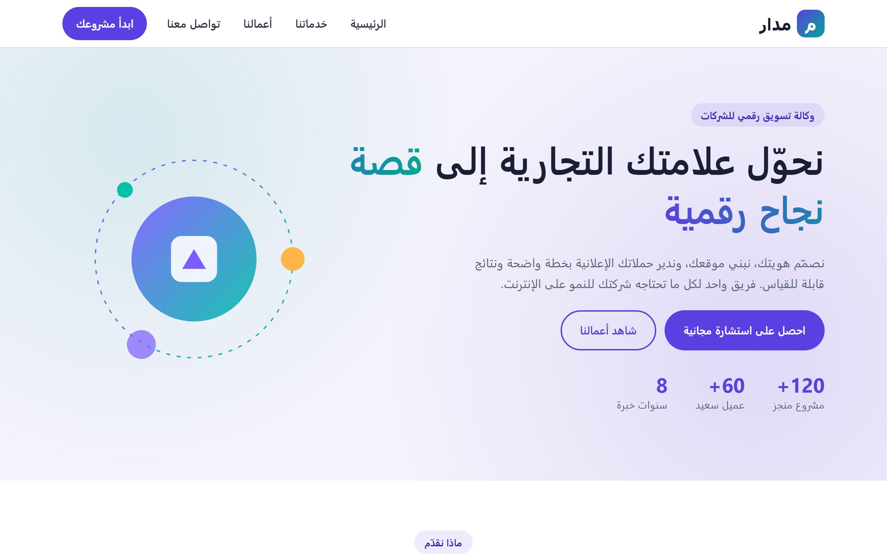
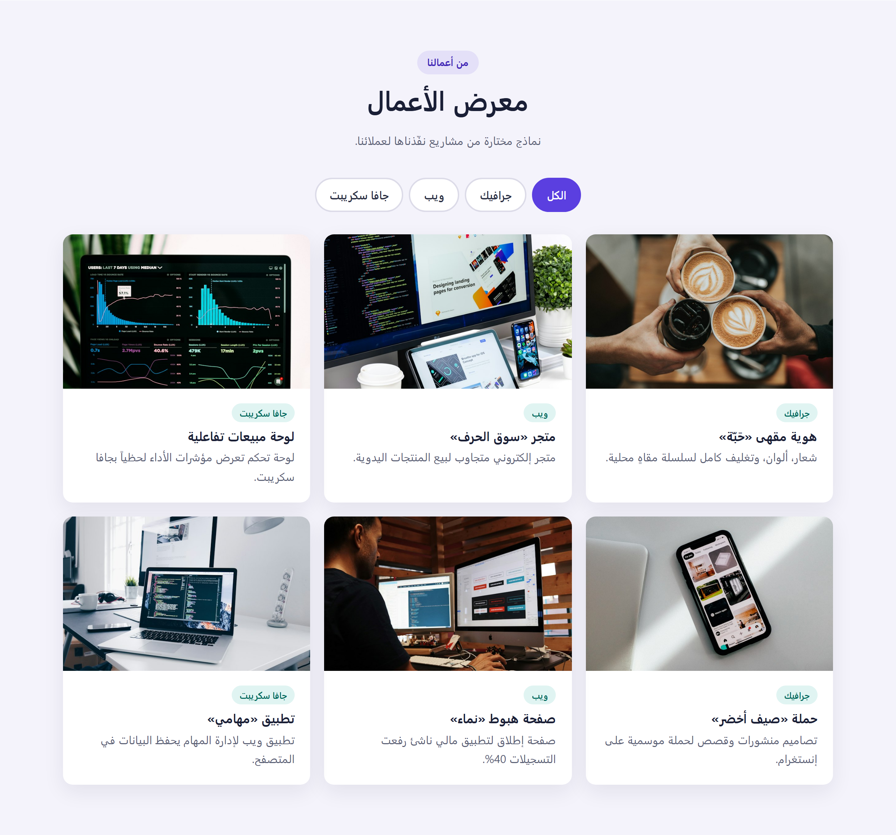
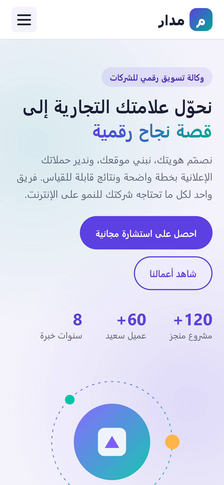
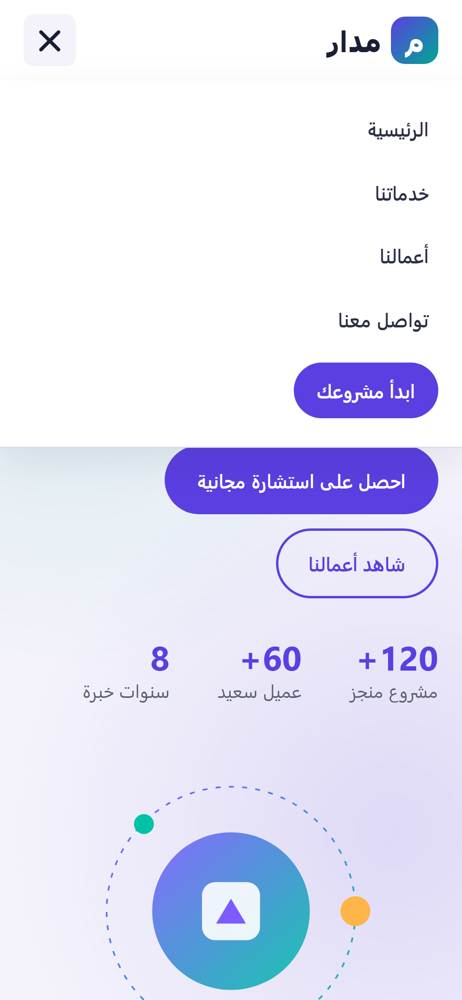

<div dir="rtl">

# مدار: صفحة هبوط لوكالة تسويق رقمي

صفحة هبوط عربية (RTL) متجاوبة لوكالة تسويق رقمي وهمية، مبنية بـ HTML5 وCSS3 وJavaScript خام **بدون أي مكتبات**. تعمل بدون إنترنت: صور معرض الأعمال محفوظة داخل المشروع في مجلد `images/`، والأيقونات SVG مضمّنة في الصفحة.



### معرض الأعمال



### على الجوال

| الصفحة الرئيسية | القائمة مفتوحة |
|:---:|:---:|
|  |  |

## المزايا

- شريط تنقل ثابت مع تنقل سلس، وقائمة همبرغر على الجوال (تُغلق عند اختيار رابط أو بمفتاح Esc، وتضبط `aria-expanded`).
- قسم رئيسي (Hero) فيه عنوان وزر دعوة لاتخاذ إجراء.
- بطاقات خدمات بـ CSS Grid وFlexbox.
- معرض أعمال مع تصفية (الكل، جرافيك، ويب، جافا سكريبت) وحركة انتقال ناعمة.
- نموذج تواصل بتحقق مخصص: حقول مطلوبة، صيغة بريد صحيحة، رسالة لا تقل عن 20 حرفاً، ورسائل خطأ مربوطة بـ `aria-describedby`. الإرسال محاكى فقط لعدم وجود خادم.
- تصميم Mobile-First، وتركيز مرئي بلوحة المفاتيح، ورابط «تخطَّ إلى المحتوى»، واحترام إعداد `prefers-reduced-motion`.

## التشغيل

افتح ملف `index.html` مباشرة في أي متصفح حديث، فلا يحتاج إلى خادم ولا إلى أي تثبيت.

## هيكلية الملفات

```
landing-page/
├── index.html      ← محتوى الصفحة وأقسامها
├── style.css       ← التنسيقات (المتغيرات في أعلى الملف)
├── script.js       ← القائمة، التصفية، التحقق من النموذج
├── images/         ← صور مشاريع المعرض (800×500)
├── screenshots/    ← لقطات شاشة عالية الدقة (2x/3x) لهذا الملف
└── README.md
```

## التخصيص

### الألوان والخطوط

كل الألوان والخطوط معرّفة كمتغيرات في `:root` أعلى ملف `style.css`. غيّر القيمة مرة واحدة فتتغير في الصفحة كلها:

| المتغير | الاستخدام |
|---|---|
| `--color-primary` / `--color-primary-dark` | اللون الرئيسي للأزرار والروابط، ودرجته الأغمق عند المرور بالمؤشر |
| `--color-accent` | اللون المساعد (التدرجات والوسوم) |
| `--color-warm` | لون التمييز وإطار التركيز بلوحة المفاتيح |
| `--color-bg` / `--color-bg-soft` | خلفية الصفحة وخلفية الأقسام الملونة |
| `--color-dark` / `--color-text` / `--color-muted` | العناوين والتذييل، والنص الأساسي، والنص الثانوي |
| `--font-main` | نوع الخط |
| `--radius` / `--shadow` | استدارة الحواف والظلال |

> عند تغيير الألوان تأكد أن تباين النص مع الخلفية لا يقل عن 4.5:1.

### إضافة خدمة جديدة

في `index.html`، داخل `<div class="services-grid">`، انسخ عنصر `<article class="service-card">` كاملاً وغيّر العنوان والوصف والأيقونة (`<svg>`). الشبكة ترتّب البطاقات تلقائياً.

### إضافة مشروع إلى المعرض

داخل `<div class="portfolio-grid">` انسخ عنصر `<article class="project-card">` وعدّل:

1. `data-category`: إحدى القيم `graphic` أو `web` أو `js`.
2. الصورة: ضع الملف في `images/` بمقاس 800×500 (نسبة 16:10)، وغيّر `src` إلى مساره، واكتب في `alt` وصفاً لما في الصورة.
3. الوسم والعنوان والوصف.

**تصنيف جديد؟** أضف زراً في `<div class="filters">` بقيمة `data-filter` جديدة (مثل `data-filter="video"`)، ثم استخدم القيمة نفسها في `data-category` للمشاريع. لا حاجة لتعديل `script.js`.

### نموذج التواصل

- قواعد التحقق ونصوص الأخطاء موجودة في الكائن `validators` داخل `script.js`، والحد الأدنى لطول الرسالة في `MIN_MESSAGE_LENGTH`.
- للإرسال الحقيقي استبدل `setTimeout` في معالج `submit` باستدعاء `fetch` إلى خادمك أو إلى خدمة نماذج.

### بيانات التواصل

اسم «مدار» وبيانات التذييل (العنوان والهاتف والبريد) **وهمية**. استبدلها ببياناتك في قسم `<footer>`.

## مصدر الصور

صور معرض الأعمال من [Unsplash](https://unsplash.com) وتخضع لـ [رخصة Unsplash](https://unsplash.com/license): مجانية للاستخدام الشخصي والتجاري، ولا تشترط ذكر المصدر. الصور توضيحية فقط ولا تمثل مشاريع حقيقية. عند استخدام الصفحة لوكالة حقيقية استبدلها بصور أعمالك الفعلية.

</div>
